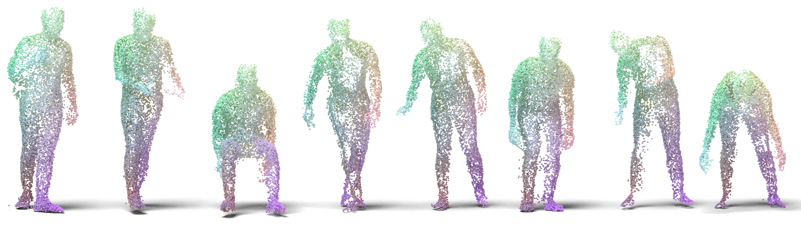
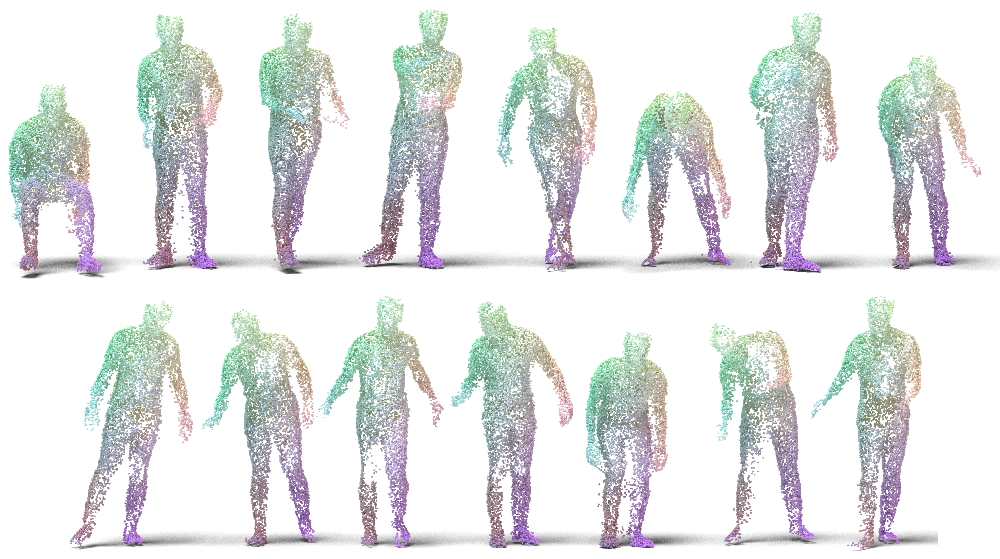
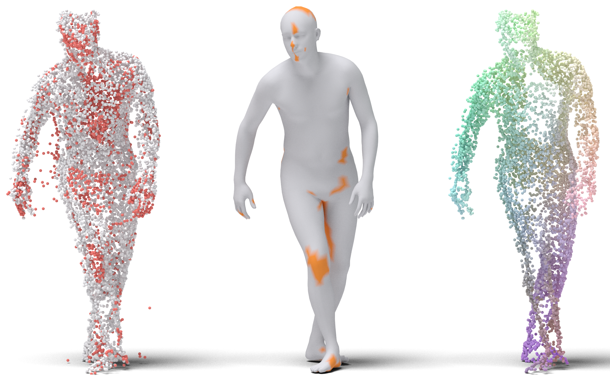
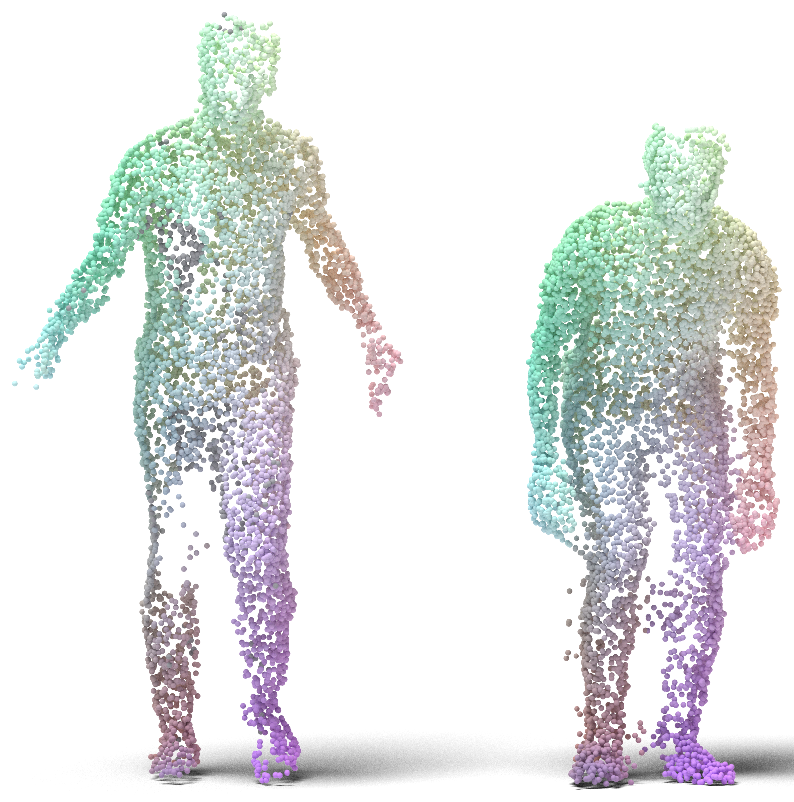

# KINECT: real Kinect point clouds with SMPL ground truth



**KINECT** is a benchmark for shape correspondence on *real* acquisitions: 15 point
clouds of a person interacting with objects, captured by Kinect sensors, with
ground-truth correspondence from an SMPL registration. The clouds are noisy and
incomplete, the way real scans are. Points are coloured by their ground-truth
location on the body: the same colour is the same place across shapes.

It is the KINECT test set of
[NAM: Neural Adjoint Maps (ACM TOG 2025)](https://doi.org/10.1145/3730943) and
**FUSE: A Flow-based Mapping Between Shapes (ECCV 2026)**.

> [!IMPORTANT]
> **This repository does not redistribute BEHAVE data.** KINECT is derived from the
> [BEHAVE dataset](https://virtualhumans.mpi-inf.mpg.de/behave/), whose
> [license](https://virtualhumans.mpi-inf.mpg.de/behave/license.html) does not allow
> redistribution. To use KINECT you must accept the BEHAVE license and download BEHAVE
> from its official page. The scripts here then rebuild the test set from your copy,
> **byte-identical** to the files used in the papers (`scripts/verify.py` checks it).
> What we ship is code, frame names, point indices and correspondence indices, plus a
> few output samples (`samples/`) so you can see the format before downloading.
> Everything built from BEHAVE remains subject to the BEHAVE license
> (non-commercial scientific research only).

## Quick start

```bash
git clone https://github.com/gviga/Kinect-Match && cd Kinect-Match
pip install -r requirements.txt

# 1. Accept the BEHAVE license and download the BEHAVE sequences of Date01
#    (all 15 frames come from it) from https://virtualhumans.mpi-inf.mpg.de/behave/

# 2. Build the test set, with the dense pairwise ground truth (about 2 minutes)
python scripts/build_dataset.py --behave /path/to/behave/sequences --out data/kinect15 --pairs

# 3. Check it is the test set of the papers
python scripts/verify.py data/kinect15          # 30/30 files identical

# 4. Evaluate your maps
python scripts/evaluate.py --data data/kinect15 --maps my_maps/
```

## The data

| | |
|---|---|
| shapes | 15 frames of BEHAVE `Date01_Sub01_*`: one subject, 15 interactions (backpack, boxes, chairs, tables, monitor, stool) |
| points | 10 000 per cloud, sampled from the fused Kinect cloud (`person/person.ply`); 7 440–9 708 after outlier removal |
| ground truth | the BEHAVE SMPL registration `person/fit02/person_fit.ply` (6 890 vertices) |
| partiality | 82–94% of the SMPL vertices have a clean point within 3 cm; on a pair, 75–98% of the points (90% on average) have a valid correspondence |
| pairs | 210 ordered pairs |



The frames, the indices of the 10k subsample and the released correspondences are in
[`splits/`](splits/). Nothing in there is BEHAVE data: only names and integers.

## Levels of ground truth

The ground truth of a real scan is only as precise as the registration, and only
exists where the sensor saw the body. KINECT therefore comes with several levels
of ground truth, so that a map can be judged precisely where it can be, and
leniently where it cannot.



*Left: the raw 10k cloud, with the points removed as outliers in red. Middle: the SMPL
registration, with the vertices no clean point sees in orange. Right: the clean cloud,
coloured by its correspondence to SMPL.*

| level | what | file / key |
|---|---|---|
| **(a) raw** | SMPL vertex ↔ nearest point, on the raw cloud | `smpl2pc`, `pc2smpl` |
| **(b) clean** | the same after outlier removal: **the NAM / FUSE test set** | `off_clean/*.off`, `corres/*.vts` |
| **(c) dense** | every clean point ↔ a clean point of any other shape, through the SMPL surface | `pairs/<x>__<y>.npz` |
| masks | `inlier` per point; `smpl_visible` per SMPL vertex; `valid` per pair correspondence | in the `.npz` files |

**Outlier removal (b).** A point is kept when the z-score of its distance to the
nearest SMPL vertex has absolute value below 1. The test is two-sided, so points
unusually *close* to the surface are dropped too; this is the setting of the
papers, kept for reproducibility. `--one-sided` keeps them, and `--z` changes the
threshold.

**Dense correspondence (c).** Each clean point of X is written on the SMPL surface
(face, barycentric coordinates, offset along the normal), carried to the same
place on the registration of Y, and matched to the nearest clean point of Y. Where Y
did not see that part of the body, the nearest point is farther than `--tau`
(3 cm) and the correspondence is marked invalid (red below).



*Dense ground truth from the left shape to the right one: each point of the left shape
takes the colour of its ground-truth image; red points have none, because the
right shape does not see them.*

The levels do not agree exactly: the SMPL-vertex ground truth (b) and the dense
ground truth (c) of the same pair differ by about 2 cm on average (1.5 cm on visible
vertices). Errors below that are within the precision of the ground truth.

## Output format

`build_dataset.py --out OUT` writes, for each shape `<name>` (`data_1011`, …):

```
OUT/off_raw/<name>.off      raw 10k cloud (OFF, points only)
OUT/off_clean/<name>.off    cloud after outlier removal
OUT/corres/<name>.vts       6890 lines: for SMPL vertex v, 0-based index into off_clean
OUT/shapes/<name>.npz       every level, below
OUT/pairs/<x>__<y>.npz      with --pairs: gt (index into off_clean of y), valid, dist, per clean point of x
OUT/meta.json
```

| key in `shapes/<name>.npz` | shape | |
|---|---|---|
| `points` | (10000, 3) | raw cloud, BEHAVE camera frame, metres |
| `scan_idx` | (10000,) | indices into BEHAVE's `person.ply` |
| `smpl_v`, `smpl_f` | (6890, 3), (13776, 3) | SMPL registration |
| `smpl2pc`, `pc2smpl` | (6890,), (10000,) | level (a) |
| `inlier` | (10000,) bool | outlier mask; `points[inlier]` is `off_clean` |
| `smpl2clean` | (6890,) | level (b), the `.vts` |
| `face`, `bary`, `offset` | (10000,), (10000, 3), (10000,) | closest point on the SMPL surface, for level (c) |
| `smpl_visible`, `smpl_dist` | (6890,) | distance from each SMPL vertex to the clean cloud, and whether it is below `tau` |

```python
from kinect import io
s = io.load_shape("data/kinect15/shapes/data_1011.npz")
clean = s["points"][s["inlier"]]       # = io.read_off("data/kinect15/off_clean/data_1011.off")
```

## Evaluation

A map from X to Y is a file `<x>__<y>.txt` (or `.npy`) with one integer per clean point
of X: the index, in `off_clean/<y>.off`, of its image.

```bash
python scripts/evaluate.py --data data/kinect15 --maps my_maps/ --out results.json
```

For every pair found it reports the mean geodesic error (on the target SMPL
registration, divided by its geodesic diameter), the mean Euclidean error (metres)
and the coverage, at each level:

- `smpl`: on the 6 890 SMPL vertices through the `.vts` files, the NAM / FUSE setting;
- `smpl_visible`: the same, only on vertices seen in both clouds;
- `dense`: on every clean point (needs `--pairs` at build time);
- `dense_valid`: the same, only where the dense ground truth is valid.

`--maps gt` evaluates the dense ground truth itself as a sanity check.

## More shapes

The same pipeline builds any other BEHAVE frame, for training or larger benchmarks:

```bash
python scripts/build_dataset.py --behave /path/to/behave/sequences --out data/kinect_all --frames all
python scripts/build_dataset.py --behave ... --out data/mine --frames my_frames.txt  # <sequence>/<frame> per line
```

New frames are subsampled with a fixed seed (`--seed`, `--n`).

## Renders

```bash
BLENDER=/path/to/blender BLENDER_TOOLBOX=/path/to/BlenderToolbox \
    python scripts/render/figures.py --data data/kinect15 --out assets
```

Needs [Blender](https://www.blender.org/) and
[BlenderToolbox](https://github.com/HTDerekLiu/BlenderToolbox).

## Repository

```
kinect/            library: BEHAVE loading, ground truth, pairwise ground truth, metrics, io
scripts/           build_dataset.py, verify.py, evaluate.py, render/
splits/            kinect15.json (frames), subsample indices, released .vts, checksums
samples/           output samples: two clean clouds, their .vts and one pair
assets/            figures
```

## License

The **code** is released under the [MIT license](LICENSE). The **data** it produces
are derived from BEHAVE and remain subject to the
[BEHAVE license](https://virtualhumans.mpi-inf.mpg.de/behave/license.html); the SMPL
registrations are also subject to the [SMPL license](https://smpl.is.tue.mpg.de/).
The files in `samples/` are provided only as an example of the format, under the same
terms. If you use KINECT, please also cite BEHAVE.

## Citation

If you use KINECT, please cite NAM, where the dataset was introduced, and BEHAVE:

```bibtex
@article{vigano2025nam,
  author    = {Vigan\`{o}, Giulio and Ovsjanikov, Maks and Melzi, Simone},
  title     = {{NAM}: Neural Adjoint Maps for refining shape correspondences},
  journal   = {ACM Trans. Graph.},
  year      = {2025},
  volume    = {44},
  number    = {4},
  articleno = {60},
  numpages  = {15},
  doi       = {10.1145/3730943},
  publisher = {Association for Computing Machinery},
}

@inproceedings{olearo2026fuse,
  author    = {Olearo, Lorenzo and Vigan\`{o}, Giulio and Baieri, Daniele and Maggioli, Filippo and Melzi, Simone},
  title     = {{FUSE}: A Flow-based Mapping Between Shapes},
  booktitle = {European Conference on Computer Vision (ECCV)},
  year      = {2026},
}

@inproceedings{bhatnagar2022behave,
  author    = {Bhatnagar, Bharat Lal and Xie, Xianghui and Petrov, Ilya A. and Sminchisescu, Cristian and Theobalt, Christian and Pons-Moll, Gerard},
  title     = {{BEHAVE}: Dataset and Method for Tracking Human Object Interactions},
  booktitle = {Proceedings of the IEEE/CVF Conference on Computer Vision and Pattern Recognition (CVPR)},
  year      = {2022},
}
```
